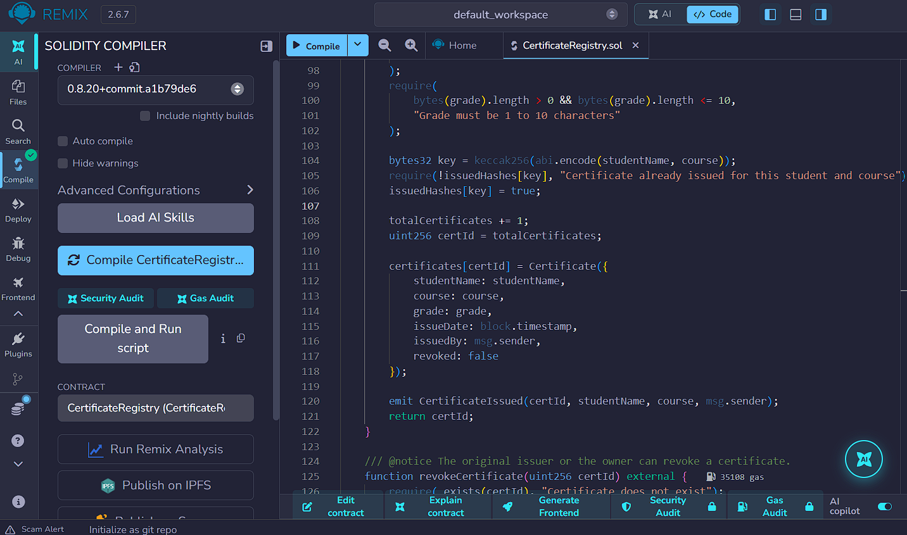
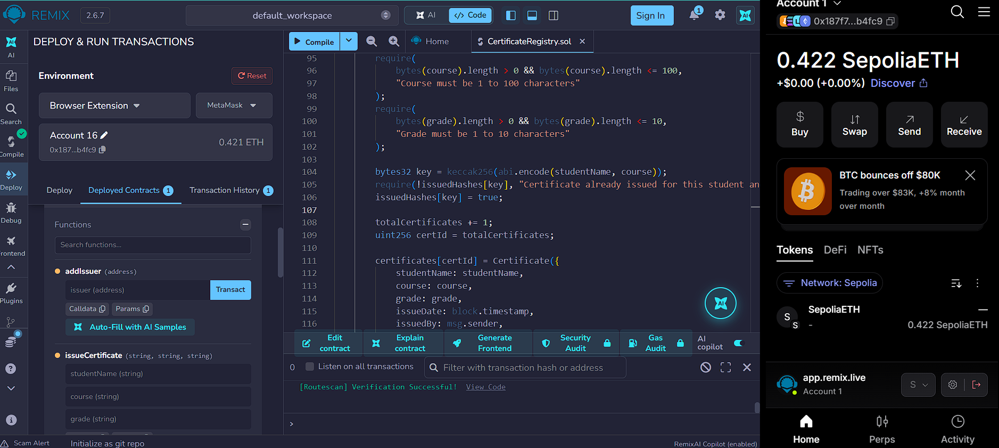
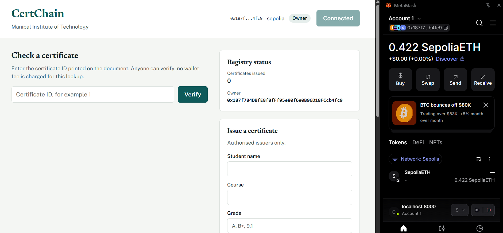
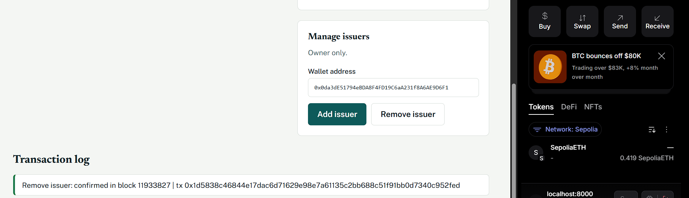
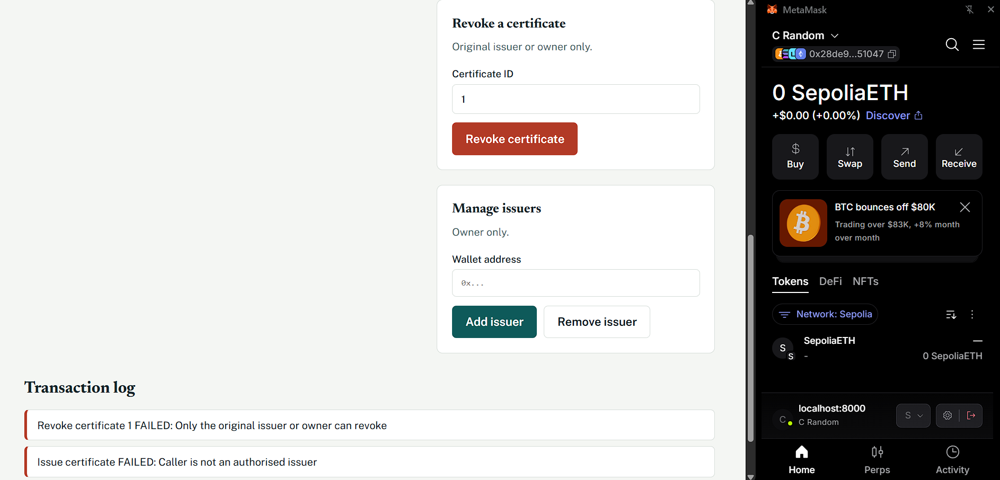
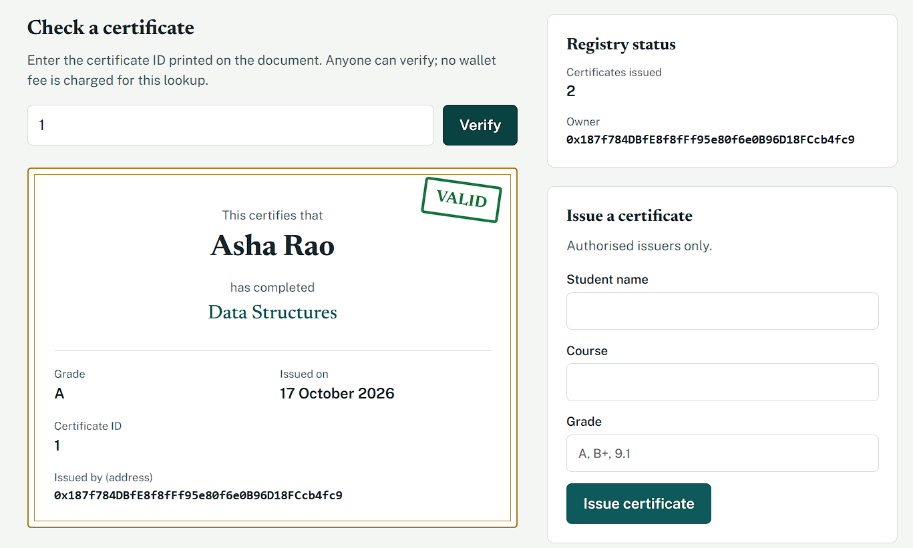
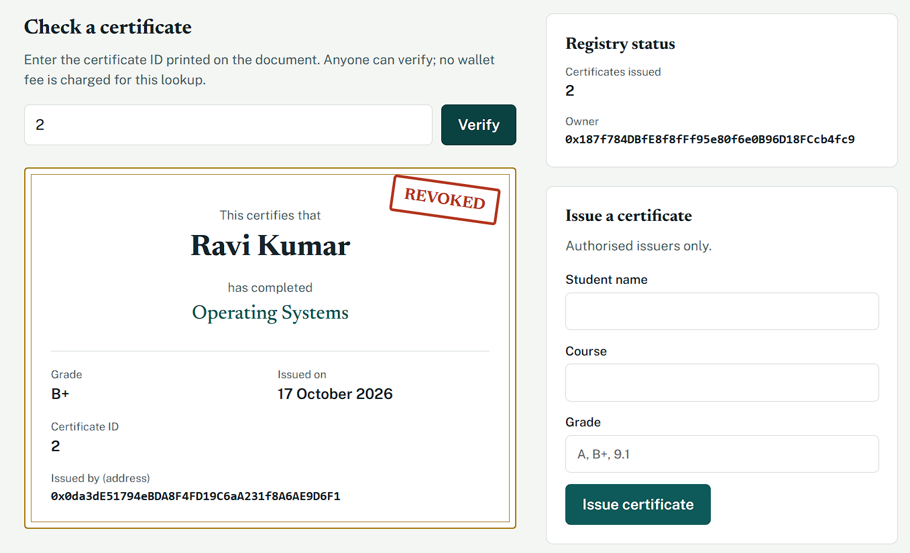

# CertChain: Blockchain-Based Academic Certificate Verification

A decentralized application (DApp) on Ethereum for issuing, verifying and revoking academic certificates.
Built for **Blockchain Technology (CSE4444), Assignment 2**.

- **Network:** Sepolia testnet (chain ID 11155111)
- **Contract address:** `0xE75f40be301B35Ec446EeE83a6C74B703C19C2E3`
- **Etherscan:** https://sepolia.etherscan.io/address/0xE75f40be301B35Ec446EeE83a6C74B703C19C2E3

---

## 1. Problem addressed

Paper and PDF certificates are easy to forge, and an employer or university usually has to email the issuing
institution to confirm one. CertChain stores each certificate on the blockchain, so anyone can verify a certificate
ID in seconds, and the record cannot be altered or silently deleted. Certificates can be revoked, and a revoked
certificate is clearly shown as revoked.

**Roles**

| Role | Can do |
|---|---|
| Owner (deployer) | Add or remove issuers, issue certificates, revoke any certificate |
| Issuer | Issue certificates, revoke certificates they issued |
| Anyone | Verify a certificate and view its details |

## 2. Project structure

```
CertChain-DApp/
  contracts/CertificateRegistry.sol   Solidity smart contract
  frontend/index.html                 User interface
  frontend/style.css                  Styling
  frontend/app.js                     Ethers.js and MetaMask logic
  deployment/deployment-details.md    Network, address, transaction hash
  screenshots/                        Evidence images
  README.md
```

## 3. Smart contract summary

- **Constructor:** sets the owner and institution name; the owner is registered as the first issuer.
- **State variables:** `owner`, `institutionName`, `totalCertificates`, plus mappings for certificates, issuers and issued hashes.
- **Functions:** `addIssuer`, `removeIssuer`, `issueCertificate`, `revokeCertificate`, `verifyCertificate`, `getCertificate`.
- **Validation:** non-empty and length-limited inputs, duplicate prevention (same student and course), zero-address check, role checks through modifiers, existence and already-revoked checks.
- **Events:** `IssuerAdded`, `IssuerRemoved`, `CertificateIssued`, `CertificateRevoked`.

## 4. Technology used

Solidity 0.8.20 or newer, Remix IDE, MetaMask, Ethers.js v6, HTML, CSS, JavaScript, Sepolia testnet.

## 5. How to run the application

### Prerequisites
- Chrome, Brave or Edge with the MetaMask extension
- Python 3 (to serve the frontend locally)
- Sepolia test ETH from a faucet

### Steps
1. Open [Remix IDE](https://remix.ethereum.org), create `CertificateRegistry.sol`, and paste the contract from `contracts/`.
2. In the **Solidity Compiler** tab, select 0.8.20 or newer and click **Compile**.
3. In **Deploy & Run Transactions**, set **Environment** to **Browser Extension** (MetaMask) with MetaMask on Sepolia.
4. Enter the constructor argument (institution name, in double quotes) and click **Deploy**. Confirm in MetaMask.
5. Copy the deployed contract address and paste it into `CONTRACT_ADDRESS` (line 4) of `frontend/app.js`.
6. Serve the frontend from the `frontend` folder:
   ```
   cd frontend
   py -m http.server 8000 --bind 127.0.0.1
   ```
7. Open `http://localhost:8000` in the browser where MetaMask is installed.

## 6. Connecting MetaMask and interacting with the contract

1. Switch MetaMask to the **Sepolia** network.
2. Select the deployer account first (it is the owner).
3. Click **Connect MetaMask** and approve the request.
4. The header shows the account address, network and role (Owner, Issuer or Visitor).
5. Use **Manage issuers**, **Issue a certificate**, **Revoke a certificate** and **Check a certificate** to interact with the contract. Every transaction appears in the **Transaction log** with its block number and hash, or the contract's revert message if it fails.
6. To test unauthorised actions, switch to another MetaMask account, refresh the page and connect again.

## 7. Deployment details

| Item | Value |
|---|---|
| Network | Sepolia testnet (chain ID 11155111) |
| Contract | CertificateRegistry |
| Contract address | `PASTE_FULL_CONTRACT_ADDRESS` |
| Deployer / owner address | `0x187f784DBfE8f8fFf95e80f6e0B96D18FCcb4fc9` |
| Deployment transaction hash | `PASTE_FULL_DEPLOY_TX_HASH` |
| Issuer account used in tests (Account B) | `0x0da3dE51794eBDA8F4FD19C6aA231f8A6AE9D6F1` |
| Deployment date | 17 October 2026 |

Sample transaction from testing: Account B added as issuer in block 11933701,
transaction `0x7fe68b76f02f3e54a4d2b99ab190d98c2ea58c120599363d9c6ab658e732c1d6`.

## 8. Test cases

Accounts: **A** = owner and deployer, **B** = issuer added by A, **C** = account with no role.

| # | Type | Action | Account | Expected result | Observed result |
|---|---|---|---|---|---|
| 1 | Valid | Deploy with institution name | A | Deployment succeeds, A is owner and issuer | Deployed on Sepolia; owner shown as A in the UI |
| 2 | Valid | Add B as issuer | A | Tx succeeds, `IssuerAdded` event | Confirmed in block 11933701 |
| 3 | Valid | Issue certificate (Asha Rao, Data Structures, A) | A | Tx succeeds, ID 1 created | Certificate ID 1 created |
| 4 | Valid | Issue certificate (Ravi Kumar, Operating Systems, B+) | B | Tx succeeds, ID 2 created | Certificate ID 2 created |
| 5 | Valid | Verify certificate 1 | Any | Shows VALID with correct details | VALID stamp shown with correct name, course, grade, date and issuer |
| 6 | Valid | Revoke certificate 2 | B | Tx succeeds, verify shows REVOKED | REVOKED stamp shown for certificate 2 |
| 7 | Valid | Remove issuer B | A | Tx succeeds, B role becomes Visitor | _Record result_ |
| 8 | Invalid | Issue with empty student name | A | Reverts: "Student name must be 1 to 100 characters" | _Record result_ |
| 9 | Invalid | Issue with empty grade | A | Reverts: "Grade must be 1 to 10 characters" | _Record result_ |
| 10 | Invalid | Issue duplicate (Asha Rao, Data Structures) | A | Reverts: "Certificate already issued for this student and course" | _Record result_ |
| 11 | Invalid | Revoke already revoked certificate 2 | A | Reverts: "Certificate already revoked" | _Record result_ |
| 12 | Invalid | Revoke certificate 99 | A | Reverts: "Certificate does not exist" | _Record result_ |
| 13 | Invalid | Verify certificate 99 | Any | UI shows "No certificate with ID 99 exists" | _Record result_ |
| 14 | Invalid | Add issuer with zero address (Remix) | A | Reverts: "Invalid issuer address" | _Record result_ |
| 15 | Unauthorised | Issue certificate | C | Reverts: "Caller is not an authorised issuer" | _Record result_ |
| 16 | Unauthorised | Add issuer | C | Reverts: "Only the owner can do this" | _Record result_ |
| 17 | Unauthorised | Remove issuer | B | Reverts: "Only the owner can do this" | _Record result_ |
| 18 | Unauthorised | Revoke certificate 1 (issued by A) | C | Reverts: "Only the original issuer or owner can revoke" | _Record result_ |
| 19 | Unauthorised | Issue certificate after being removed | B | Reverts: "Caller is not an authorised issuer" | _Record result_ |
| 20 | Invalid | Add an address that is already an issuer | A | Reverts: "Address is already an issuer" | Reverted with "Address is already an issuer" |

## 9. Screenshots

**Smart contract compilation**



**Smart contract deployment**



**MetaMask wallet connection**



**Successful transaction**



**Failed transaction**



**Blockchain data displayed through the user interface (valid certificate)**



**Revoked certificate shown in the interface**



## 10. Security note

No private keys, seed phrases, passwords or other credentials are stored in this repository. The contract was deployed
and tested only on the Sepolia test network with test ETH that has no monetary value.
